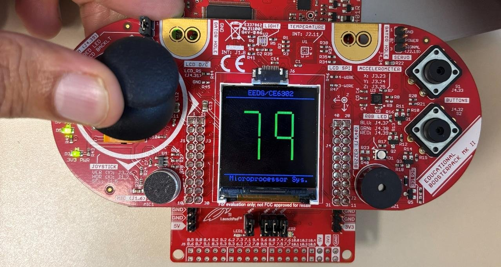
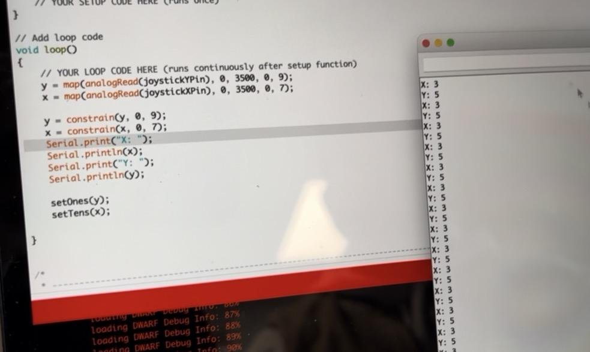

# 🕹️ JoyDigit — Joystick-Controlled Digital Display (ARM Cortex-M4)

> **Turn a thumbstick into a two-digit display, live on the MSP432.**


Reads the analog joystick on the **Educational BoosterPack MKII** with the MSP432's 12-bit ADC, scales each axis to a single digit and renders a two-digit number (**00–79**) as a seven-segment display drawn on the BoosterPack's 128×128 LCD.

| Joystick axis | Digit | Range |
|---|---|---|
| X | tens | 0 – 7 |
| Y | ones | 0 – 9 |

<p align="center"></p>

## Hardware & Software

- TI **MSP-EXP432P401R / MSP-EXP432P4111** LaunchPad (ARM Cortex-M4F @ 48 MHz)
- TI **BOOSTXL-EDUMKII** Educational BoosterPack MKII (joystick, HX8353E LCD)
- **Energia IDE** with *Energia MSP432 EMT RED Boards* package

## Repository Structure

```
├── src/JoystickSevenSegment/JoystickSevenSegment.ino   # Energia sketch
└── images/                                             # Results & screenshots
```

## How It Works

```cpp
analogReadResolution(12);                                 // 0 – 4095
y = map(analogRead(joystickYPin), 0, 3500, 0, 9);         // ones digit
x = map(analogRead(joystickXPin), 0, 3500, 0, 7);         // tens digit
y = constrain(y, 0, 9);
x = constrain(x, 0, 7);
setOnes(y);
setTens(x);
```

1. The joystick's X (pin 2) and Y (pin 26) potentiometers are sampled with 12-bit resolution.
2. `map()` linearly scales the usable ADC range (0–3500) to a digit; `constrain()` clamps anything above it.
3. `setTens()` / `setOnes()` draw each digit from a 7-segment bit mask using `dRectangle()`. Values > 9 show an **E** and an error banner.
4. X/Y digits are also printed to the Serial Monitor at 9600 baud for debugging.

## Build & Run

1. Install Energia and the *Energia MSP432 EMT RED Boards* package.
2. Select board **RED LaunchPad w/ msp432p401r EMT (48MHz)** and the correct serial port.
3. Sanity-check with *File → Examples → 01.Basics → Blink*.
4. Power off, mount the BoosterPack MKII (check the 3V3/5V/GND alignment).
5. Open `src/JoystickSevenSegment/JoystickSevenSegment.ino`, compile and upload.
6. Move the joystick; open the Serial Monitor at **9600 baud** to see the X/Y digits.

## Results

| LCD output | Serial monitor |
|---|---|
|  |  |

The display tracked joystick displacement smoothly in real time, confirming correct ADC sampling, scaling and digit separation.

## Concepts Covered

- Analog-to-digital conversion and resolution (`analogRead`, `analogReadResolution`)
- Range scaling with `map()` / `constrain()`
- LCD graphics API: `Screen_HX8353E.begin()`, `setPenSolid()`, `clear()`, `dRectangle()`, `dLine()`, `gText()`

## Credits

The seven-segment drawing helpers are adapted from the MSP432 seven-segment LCD framework by Qilin Si & Max Steele.

## Authors

- **Shrinath Abhay Palwankar**
- **Aryan Verma**
